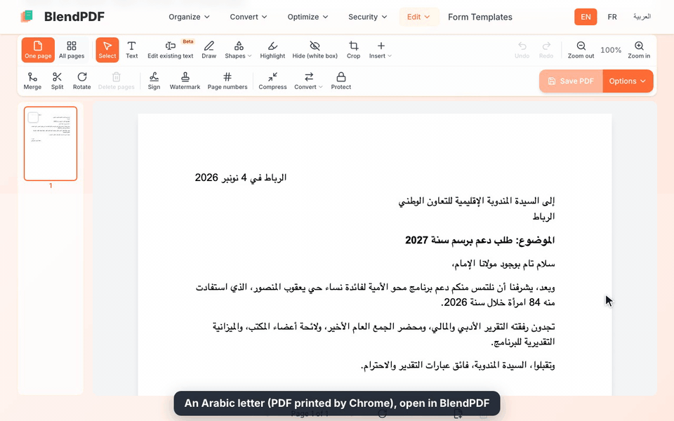

# BlendPDF

Free PDF tools in English, French, Spanish and Arabic. This is the code behind
[blendpdf.com](https://blendpdf.com).

The part worth a look is the editor. You can open a PDF, change the Arabic
text that is already in it, add new Arabic lines, and save. Letters join the
way they should, numbers inside a right-to-left line still read left to
right, the changed line keeps the document's own font when the file makes
that possible, and the text you edited can still be searched and copied. All
of it runs in the browser: the file is not uploaded for editing.



*Recorded on blendpdf.com: a new line typed with the Text tool, a surname changed with Edit existing text, then both words searched in the saved file with pdf.js.*

There is a longer write-up of how this works, and of what still fails, at
[blendpdf.com/blog/editing-arabic-text-in-pdf](https://blendpdf.com/blog/editing-arabic-text-in-pdf).

## Why Arabic is the hard part

A PDF stores glyphs, not letters. For Latin text that mostly doesn't matter.
For Arabic it does:

- **Shaping.** An Arabic letter has up to four shapes depending on whether it
  joins the letter before it, the one after, both or neither. Lam followed by
  alef becomes one glyph. New text has to be shaped into those glyphs before
  it is written, and pdf-lib's `drawText` can't do it (no bidi, and it drops
  every GPOS offset).
- **Direction.** The line runs right to left, but numbers and Latin words in
  it run left to right. That is the Unicode bidi algorithm, and it has to run
  per line after the line breaks are known.
- **Searchable text.** What makes a glyph searchable is its entry in the font's
  ToUnicode map. Get it wrong and the page looks right but nobody can find
  the word. Producers get it wrong too: Chrome writes Times New Roman's
  reverse cmap into ToUnicode, so some Arabic letters come out named as their
  Persian look-alikes (ی for ي, ھ for ه), and an Arabic search misses them.
- **Editing in place.** Changing a line means taking the old glyphs out of the
  page content without disturbing anything else, then drawing the new words
  with glyphs that match the rest of the line. Usually the embedded font is a
  subset that only has the glyphs the document already used.

## What runs where

If `pdf-lib`, `pdf.js` or PDFium (as WebAssembly) can do the job, it runs in
the browser and the file stays on your machine. If it needs a native
program, the file goes to the server, is processed there, and is not kept:
routes that need temporary files delete their folder when they finish.
Two server tools (images to PDF and form filling) only use pdf-lib and could
move to the browser. That would make a good first PR.

**In the browser:** edit text (Arabic and Latin), add text, images,
signatures and stamps, merge, split, extract pages, delete pages, reorder,
rotate, crop, watermark, page numbers, flatten, remove metadata, PDF to text,
extract images.

**On the server:** compress (Ghostscript), OCR (ocrmypdf and Tesseract, in
Arabic, English and French), PDF to Word, PDF to Excel, PDF to images, PDF to
PDF/A (checked with veraPDF), Word, Excel and PowerPoint to PDF (LibreOffice),
images to PDF, password protect and unlock (qpdf), repair, and filling form
fields.

The workspace runs one save as a pipeline (`lib/workspace/save.ts`), so a
single save can mix both: your edits are applied in the browser, then the
result goes to the server only if you also asked for something like
compression or a password.

## How the Arabic editing works

The code is split by job. Each folder has a long comment at the top of its
main files explaining the decisions.

- `lib/pdf-text/` writes **new** text. bidi-js resolves direction (UAX #9),
  fontkit shapes each run with the font's GSUB and GPOS tables, and every
  glyph is placed with its own text matrix through pdf-lib. pdf-lib is pinned
  to exactly 1.17.1 because this needs four of its internals; a test fails if
  they move. A glyph that stands for several right-to-left characters (lam
  alef) gets its ToUnicode entry reversed, because viewers flip RTL text back
  to logical order after extracting it, including the inside of that entry.
- `lib/edit-pdf/keep-font/` **changes** an existing line in its own font. It
  reads every line the document draws in that font and records which glyph is
  used for each letter in each joining form, plus kerning, mark offsets and
  ligatures. A changed word is shaped into those glyphs. Words you didn't
  touch are redrawn from their original glyphs at their original positions.
- `lib/edit-pdf/keep-font/lookalike.ts` handles the case where the subset
  doesn't have a glyph you typed. The line is redrawn in the closest bundled
  font: Liberation Sans, Serif and Mono, Carlito, Caladea, Noto Sans Arabic or
  Cairo, all self-hosted with their licences in `public/fonts/`. Amiri and
  Noto Naskh Arabic are left out on purpose; the comment explains why.
- `lib/edit-pdf/replace.ts` takes the old line out with PDFium. Every page it
  rewrites is rendered before and after, and if anything outside the edited
  lines changed, the page is refused instead of saved. That check is what
  catches pages with text shadows or soft masks, which PDFium 2.15.1 drops when
  it rewrites a page. The saved file is opened again to make sure no old glyph
  is left on a replaced line.
- `lib/edit-pdf/prefill.ts` reads a line back into the edit box in logical
  order, glyph by glyph, and folds the Persian look-alike letters back to
  Arabic when the line is Arabic.

## Running it

Needs Node 22 (`.nvmrc`).

```bash
npm ci
npm run dev
```

Open http://localhost:3000, or add /fr, /es or /ar for the other languages.
Every browser tool works with nothing else installed.

The server tools shell out to native programs. On Debian or Ubuntu,
`scripts/provision-server.sh` installs them: qpdf, Ghostscript, poppler,
LibreOffice, ocrmypdf, Tesseract with Arabic and French data, a JRE, veraPDF,
and the Python packages for PDF to Word and PDF to Excel. On macOS most of
these are in Homebrew. A missing program only breaks the route that needs it.

Optional settings (email delivery, analytics, Google Drive import) are listed
in `.env.example`. None are needed to run the app.

## Tests

```bash
npx tsc --noEmit
npm test
```

These are the two gates CI runs, plus `npm audit` for critical advisories.
The editor tests run real PDFs from `tests/fixtures/edit-pdf/`, including
Arabic files printed by Chrome and LibreOffice. `npm run lint` is not a gate: the
codebase has a backlog of old lint errors (see CONTRIBUTING).

## Layout

```
app/[locale]/        pages, one folder per tool, plus guides and comparisons
app/api/             server routes for the tools that need native programs
components/          UI; components/workspace and components/edit-pdf are the editor
lib/edit-pdf/        the editor: reading lines, replacing them, exporting
lib/pdf-text/        bidi, shaping and glyph placement for new text
lib/workspace/       the save pipeline shared by every workspace tool
messages/            UI copy in en, fr, es and ar
scripts/             provisioning and build-time generators
tests/               Vitest suites and PDF fixtures
```

Stack: Next.js 16 (App Router), React 19, TypeScript, Tailwind, next-intl,
pdf-lib, pdf.js, PDFium via @embedpdf/pdfium, fontkit, bidi-js, Vitest.

## Languages

The UI has 2,489 strings in each of English, French, Spanish and Arabic,
with no missing keys. Arabic gets a real right-to-left layout, not mirrored CSS on an
English page.

To add a language, copy `messages/en.json` to `messages/<locale>.json`, add
the locale to `i18n/routing.ts`, and if it is written right to left, to
`localeDir` in `i18n.ts`. Persian, Urdu and Hebrew translations would be
welcome.

## License

- **Code:** [GNU AGPL-3.0](LICENSE). Use it, change it, run it. If you run a
  modified version as a service other people use, you have to offer them your
  source too.
- **Content:** [all rights reserved](CONTENT-LICENSE). That covers the UI
  copy, FAQ answers, guides, comparison pages and their screenshots. It's the
  part a scraper would lift to put up a clone of the site. If you want to use
  some of it, open an issue and ask.

Copyright (c) 2026 ogcalyps.

## Name and logo

"BlendPDF" and the logo are not covered by either licence. A fork is welcome,
but it needs its own name and logo, and it shouldn't present itself as
BlendPDF or as affiliated with it.

## What's not in this repository

The site's private back office (its analytics dashboards and the jobs behind
them) and the deployment setup stay private. Nothing a visitor's browser
loads depends on them, and the app runs without them.

Contributions: [CONTRIBUTING.md](CONTRIBUTING.md). Security reports:
[SECURITY.md](SECURITY.md), please not as a public issue.
