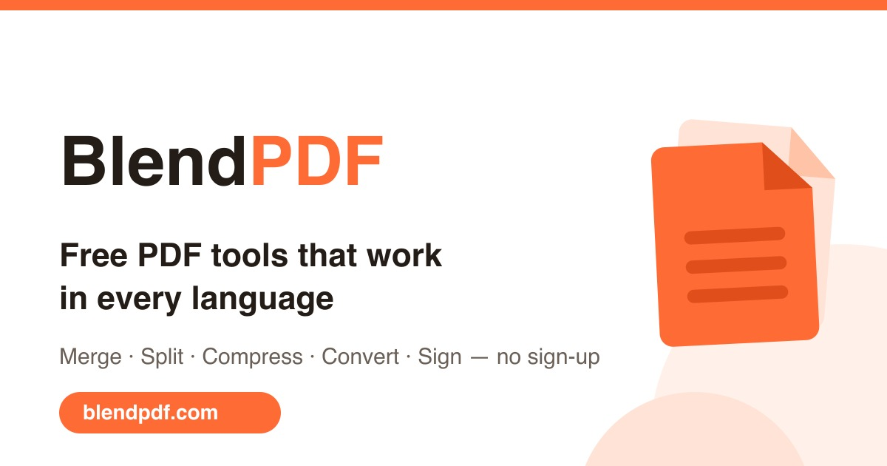

# BlendPDF

**PDF tools that treat Arabic as a first-class language.** 27 tools, fully
bilingual English/Arabic with real RTL layout, and most of them run entirely
in your browser — your files never leave the machine.



Live at **[blendpdf.com](https://blendpdf.com)** · No sign-up, no watermarks,
no upload for browser-side tools.

## Why this exists

The open-source PDF space is well served for English — [Stirling
PDF](https://github.com/Stirling-Tools/Stirling-PDF) is excellent and you
should use it if English is all you need.

Arabic is a different story. Most PDF tooling breaks on it in ways that are
easy to miss if you don't read the language: text renders unshaped
(disconnected letterforms), bidirectional runs get reordered wrongly, RTL
layouts are LTR layouts with `direction: rtl` bolted on, and OCR either isn't
offered or is trained on Latin script. That's the gap this project exists to
close.

Concretely:

- **1,757 translated strings at full parity** across English and Arabic — not
  a partial translation with English fallbacks
- **Real RTL layout**, not mirrored CSS — including form fields, signature
  placement, and page-order controls
- **Arabic OCR** via Tesseract's `ara` traineddata, alongside English and French
- **Hijri date handling** in form filling, with a test suite
- **Arabic-native document templates** — NDA, employment contract, lease

## Tools

**Organize** — merge · split · extract pages · delete pages · reorder ·
rotate · crop · add page numbers

**Convert** — PDF↔Word · PDF↔Excel · PDF→images · PDF→text · PowerPoint→PDF ·
images→PDF

**Optimize** — compress · repair · flatten · remove metadata · extract images

**Secure** — password-protect · unlock · sign (free signature placement)

**Text** — OCR (Arabic, English, French)

**Forms** — fill PDF forms · bilingual templates · batch fill from an
editable grid

**Other** — watermark

## Architecture

The interesting design decision is the **browser-first split**.

Anything that can be done with [`pdf-lib`](https://pdf-lib.js.org) or
[`pdf.js`](https://mozilla.github.io/pdf.js/) runs client-side in a Web
Worker — merging, splitting, rotating, watermarking, signing, metadata
stripping, page manipulation. Those files are never uploaded anywhere. This
isn't a privacy marketing line; there is no network round-trip in the code
path.

The remainder needs native binaries and therefore a server: OCR
(`ocrmypdf`/`tesseract`), Office conversion (LibreOffice), aggressive
compression (Ghostscript), and table extraction (`tabula`). Those live in
`app/api/*` as Next.js route handlers that shell out to the binaries listed in
`scripts/provision-server.sh`.

```
app/[locale]/          Localized pages — one directory per tool
app/api/               Server-side route handlers (native-binary tools)
components/            Shared UI
lib/                   PDF pipeline, i18n helpers, FAQ content, AWS clients
workers/               Web Worker entry for client-side processing
messages/{en,ar}.json  All UI copy and FAQ content
strapi/                Optional blog CMS (see below)
scripts/               Build-time generators + server provisioning
tests/                 Vitest suites
```

Stack: Next.js 16 (App Router) · React 19 · TypeScript · Tailwind ·
next-intl · Zustand · Vitest.

## Quick start

Requires Node 20+.

```bash
npm install
npm run dev
```

That's enough for every browser-side tool. Open http://localhost:3000 for
English or http://localhost:3000/ar for Arabic.

Copy `.env.example` to `.env.local` if you want to configure the optional
integrations — none are required for local development, and the app degrades
gracefully without them.

### Enabling the server-side tools

The conversion, OCR, and compression routes shell out to native binaries. On
Debian/Ubuntu:

```bash
bash scripts/provision-server.sh
```

That installs qpdf, Ghostscript, poppler-utils, LibreOffice, ocrmypdf,
Tesseract (with Arabic and French language data), a JRE, and the Python
packages (`pypdf`, `pdf2docx`, `tabula-py`). It is idempotent and verifies
every binary at the end. On macOS the equivalents are available via Homebrew.

A missing binary fails that one route; the rest of the app is unaffected, so
you can develop against a partial install.

### Optional: the blog CMS

`strapi/` is a self-contained Strapi instance backing the blog. It is
genuinely optional — if no CMS is reachable, blog routes render empty and the
build still succeeds. To run it:

```bash
cd strapi && npm install && npm run develop
```

Then set `STRAPI_URL=http://localhost:1337` in `.env.local`.

## Tests

```bash
npm test              # vitest
npx tsc --noEmit      # type check
npm run lint
```

## Adding a language

1. Copy `messages/en.json` to `messages/<locale>.json` and translate it.
2. Add the locale to the list in `i18n/` and to `middleware.ts`.
3. For an RTL language, add it to the RTL set so layout direction flips.

Partial translations are fine — `next-intl` falls back to English per key, and
the FAQ system uses `t.has()` gating so untranslated sections are omitted
rather than shown in the wrong language.

## Contributing

See [CONTRIBUTING.md](CONTRIBUTING.md). Arabic and RTL fixes are the most
valuable contributions here — if you read Arabic natively and something reads
awkwardly or renders wrong, that's a bug worth filing even without a patch.

## License

**Dual-licensed, deliberately:**

- **Code** — [MIT](LICENSE). Fork it, ship it, sell it.
- **Content** — [all rights reserved](CONTENT-LICENSE). The UI translations,
  FAQ answers, and marketing copy are not covered by MIT.

The reasoning is in [CONTENT-LICENSE](CONTENT-LICENSE): the code is meant to be
reused, the hand-written bilingual copy isn't meant to be lifted wholesale into
a duplicate site. Want to use the content? Open an issue and ask.

## Security

Found a vulnerability? See [SECURITY.md](SECURITY.md) — please don't open a
public issue for it.
